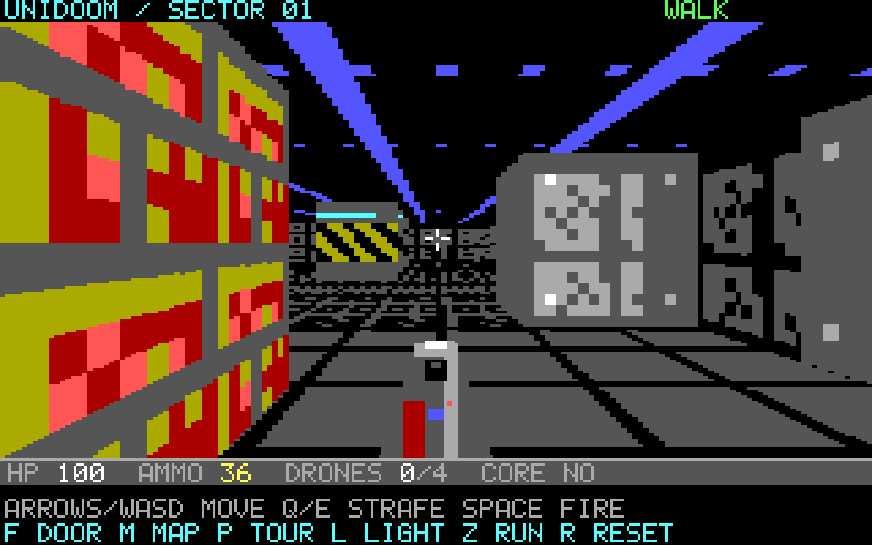
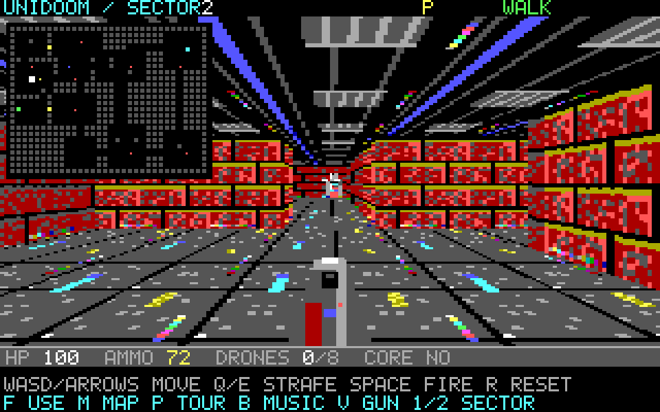
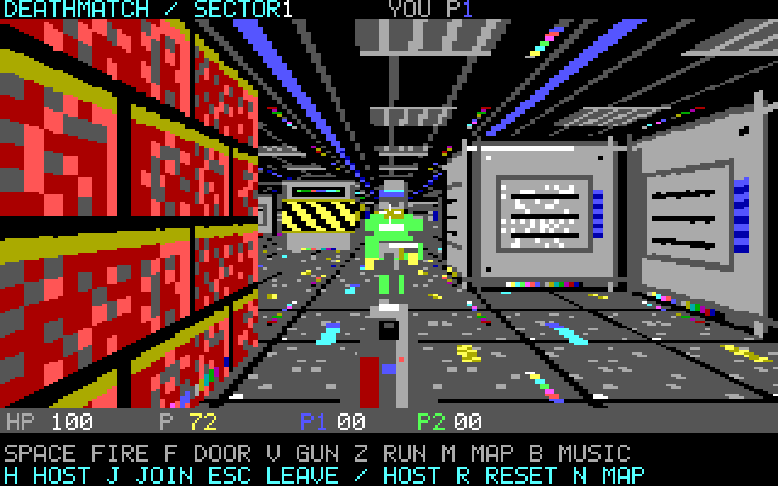

# uniDUUM

Three Doom-style raycasting demos for the **Sharp MZ-800 and UniCard mk3b**. The Sharp handles input and machine setup; native ARM code on the UniCard runs the game and renders a 320×200, 16-colour display.

Each MZF contains its maps, graphics and game code. No Doom WAD or external game data is needed to play.

## Choose a flavour

| Edition | Current version | Gameplay | Display path | Downloads |
| --- | --- | --- | --- | --- |
| **UniDoom Classic** — [`doom/`](doom/) | v0.1 | One 16×16 sector, four drones, pistol, lifting doors, data core and exit | ARM renders; Z80 copies the frame to Sharp VRAM | [MZF](unidoom_v0_1.mzf) · [Source ZIP](unidoom_v0_1.zip) |
| **UniDoom Direct** — [`doom_direct/`](doom_direct/) | v0.6 | Two different 32×24 sectors, eight moving drones, keys, secrets, pistol/shotgun, music and effects | ARM presents directly to the UniCard VGA buffer | [MZF](unidoom_direct_v0_6.mzf) · [Source ZIP](unidoom_direct_v0_6.zip) |
| **UniDoom NET** — [`doom_net/`](doom_net/) | v0.2 | Direct's single-player game plus **2–4-player Ethernet deathmatch**, marine sprites, respawning and frag scores | Direct UniCard VGA output, with synchronized network inputs | [MZF](unidoom_net_v0_2.mzf) · [Source/server ZIP](unidoom_net_v0_2.zip) |

Choose **Direct** for the expanded single-player game, **NET** for LAN deathmatch, or **Classic** to explore the original Sharp VRAM transfer harness. Older versioned MZFs and ZIPs remain available in the repository root.

### Classic

Recover the data core from the northeast room and return to the southwest exit. Fight the security drones, use doors for cover, and collect the medkit. `P` starts a guided play-through.



[Detailed Classic documentation](doom/README.txt) · [Animated tour](doom/previews/tour.gif)

### Direct

Explore two independently built sectors with patrolling drones that navigate around walls. Collect the blue key and data core, discover the secret supply cache, and reach the exit. Features include animated reactors, hit particles, a shotgun, god mode, sound effects and a PSG arrangement of the supplied **E1M1 / At Doom's Gate** MIDI.



[Detailed Direct documentation](doom_direct/README.txt) · [Map comparison](doom_direct/previews/maps.png) · [Memory budget](doom_direct/MEMORY.txt)

### NET

One player per machine, with **exactly 2, 3 or 4 players selected by the host**. Opponents use original humanoid marine sprites with helmets, rifles, armour and boots, in four team colours. First to **10 frags** wins. Death triggers an automatic respawn; spawn protection ends when firing.

Brief packet delays retain the last game frame. A sustained stall displays one warning after **800 ms**; ten seconds without progress ends the match. Single-player remains available, including its original drone graphics.



[Detailed NET documentation](doom_net/README.txt) · [Marine sprite sheet](doom_net/previews/players.png) · [Memory budget](doom_net/MEMORY.txt)

## Hardware and firmware

All three editions require a Sharp MZ-800 with 320×200, 16-colour graphics and a UniCard mk3b with the **OpenCPU ARM execution interface**. Classic also requires the Sharp's 32 KB video RAM configuration for its display path.

| Edition | Required firmware interface |
| --- | --- |
| Classic | OpenCPU upload, execution and framebuffer readback, using ports `50h`/`51h` and commands `CAh`–`CEh` |
| Direct v0.6 | OpenCPU plus the firmware-published VGA buffer pointer described below |
| NET v0.2 | Direct's interfaces plus Ethernet and BomberNet-compatible **NET commands `A0h`–`A9h`**; `INFO` (`95h`) must advertise feature bit `08h` in byte 3 |

Direct and NET read a little-endian, 32-bit pointer from **`0x08008228`** on every ARM entry. The resulting video-buffer base must be within **`0x10000000`–`0x10008000`, inclusive**. `0x08008228` is the location of the pointer, not the pixels. Invalid metadata stops the host with a red border; there is no fixed-address fallback in these current editions.

## Play a single-player game

Copy the chosen `.mzf` to the UniCard and load it with your usual MZF loader. The programs load and execute at `3000h`. The MIDI file and Python tools are build inputs, not files that need to accompany the MZF on the Sharp.

| Key | Action |
| --- | --- |
| Arrows / `W A S D` | Forward/backward and turn left/right |
| `Q` / `E` | Strafe left/right |
| `SPACE` | Fire; hold for repeated shots |
| `F` | Use a nearby door; Direct/NET also use secret walls |
| `M` | Toggle minimap |
| `P` | Start/stop the guided tour; movement takes control |
| `L` | Toggle light cone |
| `Z` | Toggle running |
| `R` / `ESC` | Restart the single-player level |
| `V` | Direct/NET: switch pistol/shotgun |
| `B` | Direct/NET: toggle music |
| `1` / `2` | Direct/NET: select and restart a sector |
| `N` | Direct/NET: next sector after completing the mission |
| `DDQD` or `IDDQD` | Direct/NET: toggle god mode |

In Direct and NET single-player, collect both the blue key and data core before returning to the green exit. Cheats and the guided tour are disabled during deathmatch.

## Play NET over a local network

### 1. Start the local server

On a PC on the same LAN, with **Python 3.10 or newer**:

```bash
python3 doom_net/server.py
```

No pip packages or internet service are required. The server listens on **TCP port 8766** on all interfaces and logs connections, room codes, player counts, readiness and match events.

Alternative launchers:

- Linux/macOS: `./doom_net/start_server.sh`
- Windows with the Python launcher: `doom_net\start_server.cmd`
- From the repository root: `make -C doom_net server`

Use `--bind <interface-address>` or `--port <port>` to change the listener. `Ctrl+C` stops it.

### 2. Point each UniCard at the PC

In the card's `/unicard/network.cfg`, set **`NETRELAYADDR`** to the PC's LAN IPv4 address and **`NETRELAYPORT`** to `8766`, using the firmware's configuration syntax. Apply/reload the configuration as required by that firmware.

The card uses the same **TCP JSON-lines relay transport** as BomberNet's UniCard implementation. The included server runs locally; it does not require the public WebSocket relay or a browser.

### 3. Create and join a match

1. Load the **same `unidoom_net_v0_2.mzf`** on every Sharp.
2. The host presses **`H`**, then selects **`2`, `3` or `4`**, including the host.
3. Other players press **`J`** and type the displayed four-letter room code. `BACKSPACE` corrects a letter.
4. The lobby shows **JOINED / NEEDED**. Joiners press **`SPACE`** when ready; the host presses it last. The match waits for the exact selected count and all players to be ready.
5. During play, the host can press **`R`** for a rematch or **`N`** to switch maps. **`ESC`** leaves and returns to single-player.

A disconnect or state desynchronization stops the match. Leave with `ESC` and create a new room. Builds with different network build IDs cannot share a match. UniDoom and BomberNet use separate game IDs.

## How the three versions work

All editions cast **160 DDA rays** through a grid-based world. The 160×160 scene uses doubled horizontal pixels inside a 320×160 viewport, with HUD and controls filling the rest of the screen. The ARM handles collision, hitscan, perspective textures, lighting, lifting doors and depth-clipped billboard sprites. The Z80 scans the keyboard at 50 Hz and communicates through the UniCard ports.

**Classic:** ARM framebuffer → UniCard readback → Z80 → Sharp VRAM. A complete frame transfer crosses the card interface.

**Direct / NET:** ARM backbuffer → UniCard VGA buffer. The Z80 performs no framebuffer readback or Sharp VRAM copy. Four bitplanes have an 8192-byte stride, with 8000 visible bytes per plane; padding remains untouched.

Code, assets, game state and the 32 KB backbuffer fit within the original **64 KB OpenCPU user window, `0x20020000`–`0x2002FFFF`**. Direct and NET also use 2 KB of ordinary Sharp RAM for streaming music history. NET stores its marine/drone replacement frames in Sharp RAM and uploads them into existing ARM sprite slots, retaining the ARM memory limit.

NET synchronizes inputs rather than video. Inputs are sent two frames ahead; all machines simulate the same completed frame in a fixed order and report a state hash every 16 frames. Local camera/HUD preferences are excluded from that hash. The slowest peer determines progress.

Direct and NET have a pacing ceiling of approximately **16.7 FPS**, not a measured hardware frame rate. Simulation advances per completed game frame.

## Build from source

Build tools: **Python 3, clang with Cortex-M4 support, `ld.lld`, `llvm-objcopy`, `llvm-nm`, and pasmo**. The recorded builds use clang/LLVM 14. Linker checks enforce the tight ARM memory budget.

All build scripts require the original **`unifractal_v0_2.mzf`** in the repository root for its hash-checked keyboard table. This input is included inside the source ZIPs. To restore it from the NET archive, run this from the repository root:

```bash
python3 - <<'PY'
from pathlib import Path
from zipfile import ZipFile

with ZipFile("unidoom_net_v0_2.zip") as archive:
    data = archive.read("unidoom_net_v0_2/unifractal_v0_2.mzf")
Path("unifractal_v0_2.mzf").write_bytes(data)
PY
```

Direct and NET additionally require the included root **`d_e1m1.mid`** to generate their E1M1 PSG arrangement.

Build an edition from the repository root:

```bash
make -C doom          # unidoom_v0_1.mzf
make -C doom_direct   # unidoom_direct_v0_6.mzf
make -C doom_net      # unidoom_net_v0_2.mzf
```

Each directory also contains a standalone `tools/build.py`. Generated ARM images, Z80 binaries, symbols, manifests and memory reports are written into that edition's `build/` directory.

## Verification

Additional test dependencies are **libz80ex** and the Python packages in [`requirements-dev.txt`](requirements-dev.txt):

```bash
python3 -m pip install -r requirements-dev.txt
make -C doom verify
make -C doom_direct verify
make -C doom_net verify
make -C doom_net verify-tcp
```

The suites execute assembled Z80 and Cortex-M4 code, compare pixels/state with native C, and check collision, doors, gameplay, memory guards and transport failures. Direct/NET also verify music and sound, both maps and firmware video-pointer handling. NET checks exact 2/3/4-player matches, marine upload/drone restoration, short and sustained stalls, and a separately launched server with real loopback TCP clients.

Existing verification results are stored in each `build/` directory. These are CPU/protocol and local TCP tests; physical mk3b operation, electrical timing and hardware frame rates still require verification. Screenshots and GIFs come from emulation or the native renderer, with approximate RGBI colours.

## Credits and further documentation

- The OpenCPU harness and keyboard mapping build on **NOBOMI-SOFTWARE's UniFractal** scaffold.
- [BomberNet](https://github.com/MZPico/BomberNet) and [MZPico firmware](https://github.com/MZPico/MZPico-firmware) document the shared UniCard-compatible NET interface. This project's relay and transport implementation are independent; BomberNet game code and assets are not included.
- [`d_e1m1.mid`](d_e1m1.mid) supplies **E1M1 / At Doom's Gate** for the two-voice-plus-percussion PSG arrangement in Direct/NET. Maps and pixel artwork are generated by the included tools.
- Edition manuals: [Classic](doom/README.txt), [Direct](doom_direct/README.txt), [NET](doom_net/README.txt).
